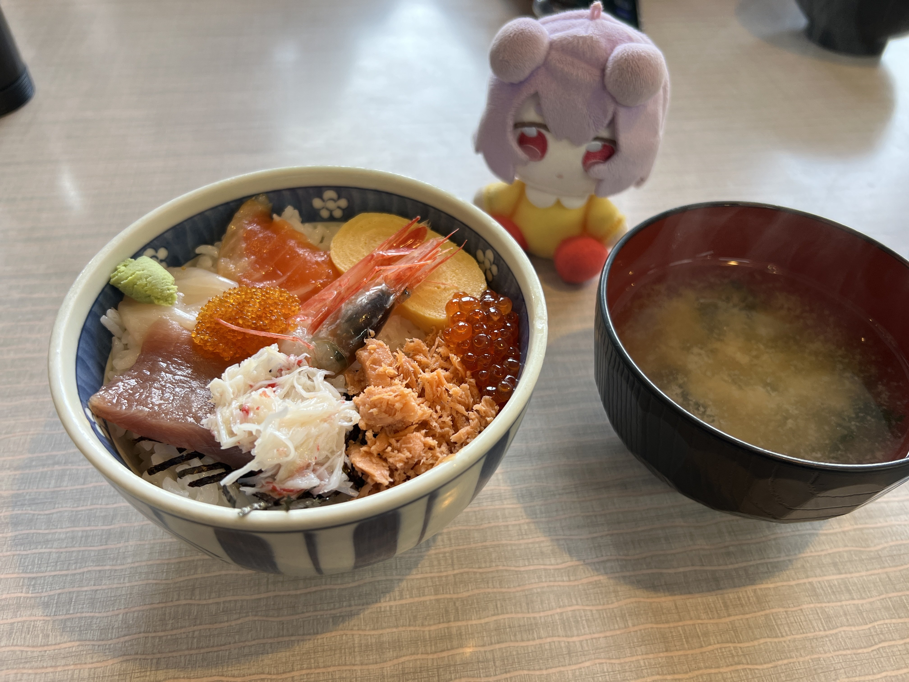
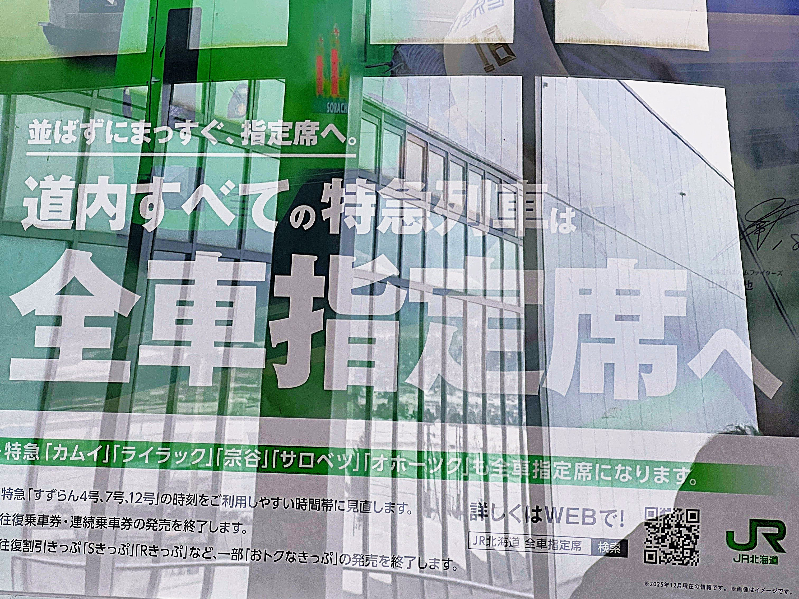
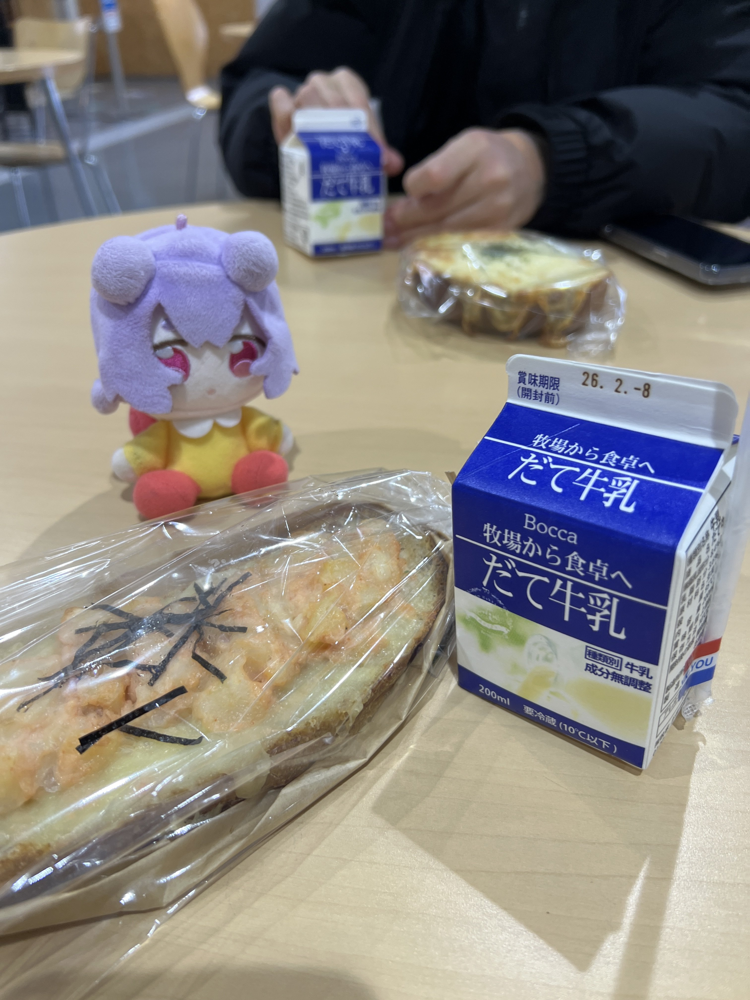
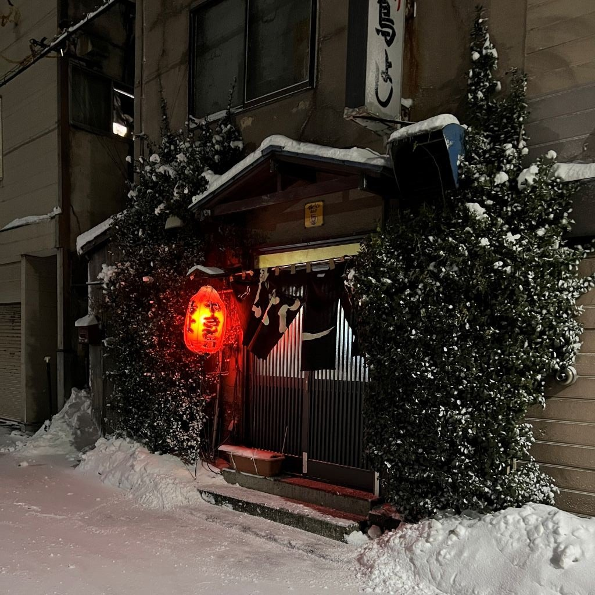
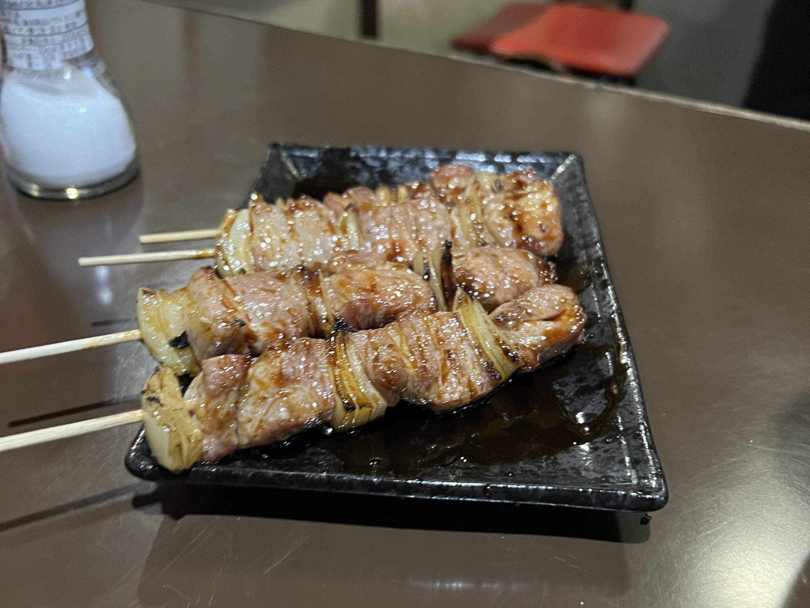
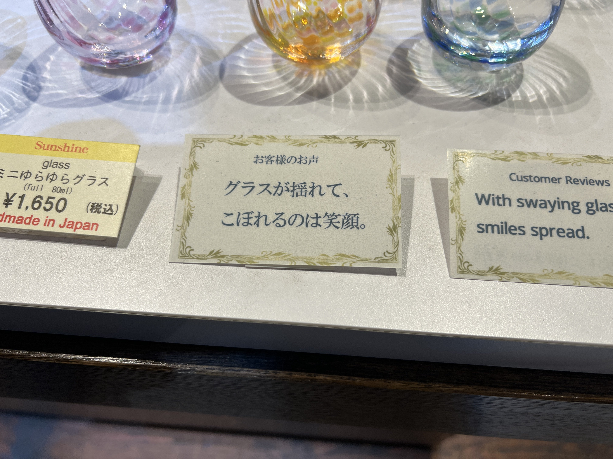
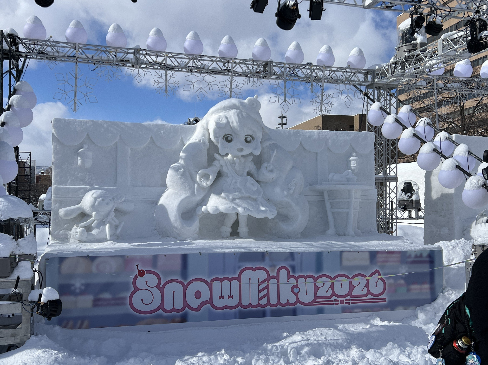

雪ミクのイベントに合わせて胆振や札幌小樽に行ってきました。

## 出発

おはようございます。ギリ寝坊しました。  
旅の始まりは函館駅と決めているので朝一の55系統で自宅前から駅まで行こうと思っていたのですが、なんか乗り遅れました。  
まあそんなもんです。

ついでに函バスが遅延してて予定の北斗に乗れないことが判明しました。  
ついでに同行者もバスに乗り遅れてました。

幸先悪いですが、旅にトラブルは付きもの。  
(まだ旅は始まってませんよ...？)

予定を組むのと腹ごしらえを兼ねて朝市に行きます。  
朝食はいつもの(?)二番館さんです。

私は500円丼と呼んでるのですが、観光客向けの函館朝市で一番お財布に優しいどんぶりです。  
量こそないですが、みそ汁とたくあんまでついて500円なら牛丼チェーンより安いですからね。  
皆さんも爆速注文＆退店して観光客を怖がらせましょう！  

そういえばこんな気狂いの旅行に付いてきてくれた同行者がいます。  
今回登場していただく**オリーブ**さんです。  

https://x.com/fun_ori333/status/2019571240248439259

なにしてるんですかね。  

## 伊達紋別で途中下車!?

寝坊したおかげでなんと伊達に寄れることが判明しました。  
元々普通長万部行きで行こうと思ってたんですが北斗に課金すると伊達紋別で一時間くらい余裕が生まれる計算に。  
なるべく特急料金を節約するために新函館北斗まではこだてライナーで行くことに。  

ファッ！？自由席好きなのに...  JR頼むよ～  

伊達紋別で下車、バスも何もなさそうなので徒歩で道の駅まで向かいます。  
今回の目的の一つである**北海道☆旅女子プロジェクト**巡りをします。

https://x.com/onnenai_w57/status/2019635476995653706

これ、ありえんくらい路面がツルッツルなんです。こんなところを2km徒歩、正気の沙汰ではないです。  
何度も転びそうになりながら国道を歩くこと20分、道の駅だてに到着。  

https://x.com/onnenai_w57/status/2019625916025217184

かわいいですね。  
なんかふざけた(失礼)格好してますが、デートの時は可愛い私服着てきてくれるのかなぁ...とか考えてました。  

ちょっと時間があったので牛乳とパンを買って小腹を満たします。  
伊達の牛乳もあるんですね。ご当地牛乳をまとめた同人誌とかあっても面白いかも。  

帰りもあり得ないくらい路面凍結してて、普通にタクれば良かったのですがなんとか歩きました。  
東室蘭行き普通列車で室蘭へ。

## 室蘭という街

東室蘭のアパに荷物を置いて、室蘭市街に向かいます。  
室蘭-東室蘭間は特例で乗車券のみで特急列車の立席指定扱いのようですね。結構需要はあるみたい。  
目指すは**道の駅カナスチールみたら室蘭**。ここにも旅女子がいます。  

https://x.com/onnenai_w57/status/2019688623625687507

蘭(あららぎ)うみさんです。髪留めが白鳥大橋になってて可愛いですね。  

道の駅からちょっと行ったところに**むろらん温泉ゆらら**という入浴施設がありましたので寄っていきます。  
今にも飛ばされそうな強風で冷えた身体には温かい温泉が沁みます...  

バスで室蘭駅まで移動。道南バスって現金と磁気式のカードしか使えなくてびっくりしました。  
輪西で降りて夕飯にありつきます。室蘭といえば**やきとり**！！  
知り合いに紹介してもらった店に足を運びます。

少し入るのに勇気がいる構えをしていますが、道南訛りがキツい店主とそのご婦人が優しく対応してくれます。  
ウーロン茶ととりあえず10本を注文。ここで出てくる豚精肉の串がとにかく美味い。美味すぎる。

言わずもがな室蘭やきとりも豚肉が基本なのですが、こんなに美味い豚串は初めて食べました。  
ネギも長ネギではなく玉ねぎなのですが、これまた辛みがアクセントになってクセになる組み合わせです。  

いやはやびっくり。たらふく20本食って2000円ちょっと、また来ます。  

## なぜわざわざ新千歳空港に？

さて、早起きは三文の徳。文句を言いながらもなんとかベッドから這い上がり、アパホテルを後にします。  

https://x.com/onnenai_w57/status/2019918800704119222

ということで苫小牧に到着。ここから普通列車で新千歳空港に寄ろうとしたものの降雪の影響で運休。  
後続の北斗に乗車券のみで空席が利用できるとのことでした。計画運休中でこのまま札幌まで行けばいいものを、何を思ったか新千歳空港に寄ります。  
人ごみの快速エアポートに詰め込まれて新千歳空港に到着。目的は雪ミクスカイタウン。  

いやまあ、これがないと北海道旅行は始まらないっしょ！  
せっかくの雪ミクイベントなので、法被を買って着ていきます。  
3000円以上のお買い上げでチロルチョコ一つプレゼント！ていうキャンペーンやってて3つ貰ったのヤバかったな...  

## 北大でLTとボカロ同好会

札幌での予定の一つ、北大x科技大x未来大での合同LT会に参加してきました。  
一応、私もマリカンの副部長をやってるらしいので軽くその場で作った函館ネタを喋ってきました。  

交流会では、札幌函館の交流が増えたらいいのにねぇ...など話していて、**北海道新幹線は道民の夢！**になってました。  

その後、弊学ボカロ同好会の人と合流して北大ボーカロイド同好会のバーチャルライブを見に行くことに。  
音響やライティングも学生団体ができる規模感ではない...！マジでいろいろ圧倒されました。  
終演後、ご案内してくださいった部長さんもありがとうございました！

https://x.com/onnenai_w57/status/2020066056837152908

コイツダルすぎ↑  

## クラブで夜を明かす
この旅程、結構直前に決めたんですよ。  
んで雪まつりシーズンの札幌でまともに宿なんて取れるわけもなく...  
なんか夜中ボカクラやってるらしいぞということで、そこで夜を明かすことにしました。  

なんか久しぶりにボカクラの雰囲気感じるな～なんて思いながら、なんとか眠気に耐え...  
SynthionのDJを聞いたりしてたらなんだかんだ時間が過ぎて4:00にイベント終了(だったかな?)  

そこからあんまり記憶がないんですが、狸小路のまねきで2時間ほど寝て、朝の快速エアポートに間に合うように札駅に行った気がします  
同行者の方申し訳ございませんでした。という感想ですね(笑)  

いやまあ宿とるとバカみたいな値段になるので、節約できたと思えば、耐え...かな。  

## 小樽うおおお雪ミク
昨日はかなり忙しい日程だったので、今日は絶対幸せになるぞ！と心に誓って小樽へ。  
早朝の快速エアポートは空いていてデカ感謝。バカ眠くてずっとうとうとしてました。  

ちょっと朝早すぎるので小樽駅の**バガキグ**で朝食。函館にも展開してよ...  
ゆっくり朝の時間を過ごしたあと、歩いて小樽観光へ。  

小樽運河周辺をざっと見た後、向かうのは北一硝子。  
小樽観光の王道でしょうが、たくさんのガラス製品を眺められてお手頃なものまで並んでるので僕はほぼ毎回訪れています。  
デスクにほどよいグラスを探していたので、いい感じの卵型のかわいらしいグラスを購入。いい買い物をした。  

## 東区住みやすそう！
今日はなんと寝床があるんですよ！！  
先輩のご実家に泊めてもらうことになっていて、既に幸せが確保されています。  

身体も冷え切ったので、まずは風呂。  
訪れたのは**こうしんの湯**。銭湯ですが、浴槽の種類が多くてとても良かったです。  

https://x.com/onnenai_w57/status/2020392041423966229

↑キモいツイートをするなどして時間を潰し...  

暖かいご家庭に泊めていただき、神になっていました。  
居心地よすぎて普通に人ん家だとは思えないほどよく眠れました。  

## 札幌観光
朝ごはんまでいただき、雪の降る中出発。  
最後に札幌をいろいろ見て回ります。  

https://x.com/onnenai_w57/status/2020676441881620780

雪ミクコラボスイーツを食べたり...(ちなみにマジで美味かった)  

https://x.com/onnenai_w57/status/2020694739482476581

函館にはないメロンブックスを覗いたり...  

https://x.com/onnenai_w57/status/2020785578610917660

札幌市電を見たり...  

めっちゃアホ面でワロタ  

いろいろ楽しんで、高速バスで札幌を後にします。  

## さいごに
なんか僕基本独りで旅行することが多いので、大体ツイートしてたり写真投稿してたりするんですが、今回は同行者がいたのでツイート減っててウケるなーなんて振り返って思ってました。
いや普通にリアルタイムで見たものをそのまま誰かと共有することってとっても健全ですからね。  

改めまして、同行者の方には変態行程に付き合っていただきありがとうございました。  

*寒い景色も嬉しいんだ　君とならこんなに嬉しいって感じてる* / 星のように夜を照らせ

https://open.spotify.com/track/5E0U5oTfzcMo6FTyu0pzeh
